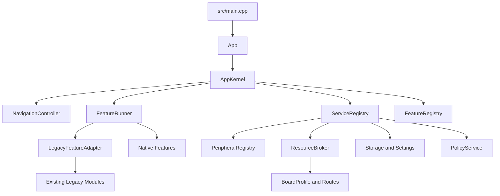

# HaleHound-CYD 3.8.1 双主板重构设计

## 文档状态

- 设计日期：2026-07-28
- 设计状态：章节设计已确认，形成书面实施基线
- 目标仓库：`E:\github\HaleHound-CYD`
- 当前代码基线：分支 `nm-cyd-c5`，起始提交 `4ff35a3`
- 功能合同：用户提供的 `README.md` v3.8.1
- 功能合同 SHA-256：`52AB85830DB157375D502CD0F2B3AF2673C7AD3135F2A9B2424AB3F0148A43B7`

本文档是本次重构的正式设计基线。仓库根目录现有 `DEVELOPMENT_PLAN.md` 仅作为早期调查资料；其中五板构建矩阵、`esp32-cyd-hat` 独立目标、PN532-SPI 和板载外设假设不适用于本设计。

不存在可供移植的 v3.8.1 源码。本项目交付的是“基于 v3.8.1 README 验收合同的兼容实现”，不得表述为官方 v3.8.1 源码移植。

## 1. 目标、范围与完成定义

### 1.1 目标

1. 将工程收敛为标准 PlatformIO 项目，仅正式支持两块主板。
2. 在当前代码上补齐用户提供 README 中的 v3.8.1 功能。
3. 用应用内核、功能注册、服务注册、资源仲裁和运行时外设探测替换超大菜单处理器与阻塞式入口。
4. 允许同一固件在未连接任何外设时正常启动、显示完整菜单，并在进入相关功能时给出可恢复的缺失设备提示。
5. 解决 NM-CYD-C5 单核执行以及显示、触摸、SD、CC1101、nRF24 共用 SPI2/FSPI 所产生的竞争风险。
6. 保持 README 规定的 SD 开放路径和用户数据兼容性。

### 1.2 正式支持范围

| 主板 | PlatformIO 环境 | MCU | Flash | 支持级别 |
|---|---|---|---:|---|
| ESP32-2432S028 | `esp32-cyd` | 经典双核 ESP32 | 4 MB | 正式支持 |
| NM-CYD-C5 | `nm-cyd-c5` | 单核 ESP32-C5 | 16 MB | 正式支持 |

以下环境从正式构建、CI、发布包和运行时板型模型中移除：

- `esp32-cyd-hat`
- `esp32-e32r28t`
- `esp32-e32r35t`

NM-RF-HAT 只作为已验证的接线和引脚复用参考，不是主板、运行时设备、功能依赖或固件变体。

### 1.3 外设范围

每个外设是独立最小单元：

- CC1101
- nRF24L01
- PN532-I2C
- IR TX
- IR RX
- RF433 TX
- RF433 RX
- GPS
- SD

相同驱动必须可用于 NM-RF-HAT 或其他符合电气和路由要求的扩展硬件。软件中不得出现 `NmRfHatDevice`、`hatPresent` 或等价的整体 HAT 依赖。

### 1.4 不在范围内

- 恢复或继续维护 E32R28T、E32R35T。
- 将 NM-RF-HAT 建成第三个固件目标。
- 假设所有外设能在启动阶段同时被探测。NM-RF-HAT 的拨码路由在物理上互斥。
- 在不具备对应分区能力时承诺通用 OTA 回滚。
- 用菜单名称、命名空间或占位页面证明功能完成。

### 1.5 完成定义

只有同时满足以下条件，重构才算完成：

1. 两个正式环境可重复构建并生成可追溯产物。
2. 两块主板在零外设条件下均可启动、操作菜单和进入设置。
3. README 每个功能条目都有行为验收证据，而不仅是入口或符号。
4. IR/RF433 扩展通过独立验收，不冒充 README 原生条目。
5. 所有功能遵守统一生命周期、策略守卫和资源租约。
6. C5 通过共享 SPI 压力测试，无死锁、CS 冲突、看门狗复位或持续资源泄漏。
7. 设置和 SD 数据迁移可恢复，更新器无法刷入错误芯片或超出分区的镜像。
8. 未完成全部 README 验收前，版本不得标记为 3.8.1 兼容正式版。

## 2. 总体架构



### 2.1 组件职责

| 组件 | 单一职责 | 不允许承担的职责 |
|---|---|---|
| `App` | Arduino `setup()`/`loop()` 与内核之间的薄入口 | 菜单数组、业务逻辑、外设访问 |
| `AppKernel` | 初始化顺序、主事件循环、服务调度和故障边界 | 具体攻击或扫描实现 |
| `FeatureRegistry` | 注册稳定功能 ID、菜单元数据、依赖和风险级别 | 初始化硬件或运行功能 |
| `FeatureRunner` | 预检、启动、tick、停止、清理和结果路由 | 直接控制 SPI、WiFi 或 BLE |
| `ServiceRegistry` | 建立并提供平台服务 | 业务菜单逻辑 |
| `PeripheralRegistry` | 独立外设描述、按需探测、状态缓存和诊断 | 表示 NM-RF-HAT 整体 |
| `ResourceBroker` | 互斥资源租约、拥有者、超时和恢复 | 协议业务实现 |
| `NavigationController` | 菜单栈、返回结果和屏幕切换 | 运行阻塞式功能循环 |
| `LegacyFeatureAdapter` | 将旧 `setup/loop/cleanup` 接入新生命周期 | 成为永久兼容层 |

### 2.2 依赖方向

业务功能只能依赖服务接口和类型化上下文。禁止业务模块直接依赖：

- 全局 `SPI`、`Wire`、`SD`、`TFT_eSPI` 实例
- CC1101、RF24、PN532 的底层库单例
- 任意板型宏或固定 GPIO
- 其他功能模块的内部状态
- 直接创建的 FreeRTOS 任务

板型差异只能存在于 `BoardProfile`、路由定义、驱动实现和 `ExecutionPolicy` 后端。

## 3. 板级模型与外设模型

### 3.1 BoardProfile

`BoardProfile` 只描述主板固有且静态的信息：

- MCU/执行策略类型
- Flash 和分区能力
- 显示、触摸、背光和安全启动按钮
- 可用 SPI/I2C/UART 控制器及引脚
- 主板 SD 接口
- 逻辑扩展信号到 GPIO 的映射

`BoardProfile` 不得包含 `hasCc1101`、`hasNrf24`、`hasPn532` 等外设存在假设。

### 3.2 ExpansionRoute

`ExpansionRoute` 描述一个独立外设可使用的接线方案，包括：

- 传输类型：SPI、I2C、UART、GPIO
- 总线 ID 和引脚映射
- CS、CE、IRQ、GDO、TX/RX 等控制信号
- 与其他路由的互斥组
- 供电、拨码或接线提示文本 ID

NM-RF-HAT 相关信息只能以若干独立路由出现在文档和路由表中。它的拨码位置 1-5 分别连接 CC1101、nRF24、PN532、IR、RF433，任意时刻只允许一个位置为 ON；因此探测必须按功能按需执行，不能在启动时宣称同时发现全部模块。

### 3.3 PeripheralDescriptor

每个外设描述符至少包含：

```text
PeripheralId
DriverId
Transport
CandidateRoutes[]
ProbePolicy
RequiredResources[]
DiagnosticProvider
```

外设状态统一为：

| 状态 | 含义 | 用户行为 |
|---|---|---|
| `Unverified` | 尚未探测或缓存已过期 | 进入功能时执行短探测 |
| `Available` | 驱动探测成功 | 允许进入功能 |
| `NotFound` | 总线可用但无有效响应 | 提示检查设备、供电、拨码和接线 |
| `Busy` | 所需资源被其他拥有者占用 | 提示稍后重试，可返回菜单 |
| `Fault` | 通讯、驱动或电气状态异常 | 显示诊断摘要并允许重试 |
| `Unsupported` | 当前主板不存在可用路由 | 显示当前板不支持该路由 |

探测失败不得阻止系统启动，不得永久隐藏菜单，也不得把外设状态写成不可恢复的全局布尔量。

## 4. C5 共享 SPI 与资源仲裁

### 4.1 C5 关键拓扑

NM-CYD-C5 的显示、触摸、SD、CC1101 和 nRF24 共用 SPI2/FSPI：

| 信号 | GPIO |
|---|---:|
| MISO | 2 |
| SCK | 6 |
| MOSI | 7 |
| Display CS | 23 |
| Touch CS | 1 |
| SD CS | 10 |

PN532 使用 I2C，不参与 SPI 事务。实现必须采用 PN532-I2C，不能保留“经典 CYD 使用 PN532-SPI、C5 使用 I2C”的分裂模型。

### 4.2 ResourceBroker 契约

`ResourceBroker` 必须提供：

- FreeRTOS mutex 或等效互斥原语
- 当前拥有者和递归获取检测
- 有界等待和明确超时结果
- RAII/作用域租约
- 获取、释放和超时诊断事件
- 总线恢复和全部 CS 取消选择

SPI 获取顺序固定为：

1. 申请总线租约。
2. 将所有已注册 CS 置为非选中。
3. 应用目标设备专属 SPI mode、bit order 和频率。
4. 选择目标设备。
5. 完成短事务。
6. 取消选择目标设备。
7. 结束事务并释放租约。

持有 SPI 租约期间禁止：

- `delay()`、任务阻塞或主动 yield
- 文件解析、屏幕布局计算或网络等待
- 等待用户输入
- 调用可能重新申请同一总线的服务

显示渲染和触摸读取同样必须通过 SPI 服务。长图形更新拆成短批次，在批次间释放总线，让触摸、SD 和射频获得运行机会。

## 5. 执行策略与单核适配

共享代码定义工作负载，不规定统一调度器。每个工作负载声明角色、优先级、最大执行切片、停止信号和所需资源。

### 5.1 ESP32-2432S028

- 允许板级后端按负载使用 `xTaskCreatePinnedToCore()`。
- 核心绑定只存在于 `ExecutionPolicyEsp32`，功能代码不得指定核心编号。
- 后台任务必须响应停止信号，并在功能清理完成前退出。

### 5.2 NM-CYD-C5

- 使用合作式 tick 或非固定核心 FreeRTOS 任务。
- 网络、扫描、解析和 UI 更新必须拆成有界工作片。
- README 中依赖“Core 0 网络/Core 1 UI”的功能改写为平台无关的生产者/消费者或时间片状态机。
- Drone Detect 的“双无线电同时工作”在 C5 上实现为可测量的交替采样窗口，不伪造双核并行。

### 5.3 共同约束

- 不强制引入统一 `TaskScheduler` 库。
- 不允许在持有资源租约时发生阻塞等待。
- 功能退出、Blue Team 拦截、初始化失败和异常路径必须走同一清理协议。
- 看门狗喂养不能掩盖无限循环或超预算工作片。

## 6. 功能注册、生命周期与导航

### 6.1 FeatureDescriptor

每个功能具有稳定 ID，显示名称不是主键。描述符包含：

```text
FeatureId
CategoryId
DisplayName
RiskClass
RequiredPeripherals[]
OptionalPeripherals[]
RequiredServices[]
StorageNeeds
Factory
```

风险级别至少区分 `Passive`、`Defensive`、`Offensive` 和 `SensitiveData`。VALHALLA、Blue Team 和 PIN 策略由 `PolicyService` 根据元数据统一执行，不得在各触摸处理器中复制门禁代码。

### 6.2 VALHALLA 协议与 Blue Team 安全模式

VALHALLA 是攻击性功能的统一责任确认协议，不是普通提示页。所有 `RiskClass::Offensive` 功能默认锁定，只有用户明确接受完整责任免责声明后才允许执行。

策略状态使用单一枚举持久化，禁止用两个可产生矛盾组合的独立布尔量表达：

| 状态 | 含义 | 允许行为 | 主屏幕标识 |
|---|---|---|---|
| `ValhallaAccepted` | 已明确接受责任免责声明 | 按功能门禁允许 Offensive | `VALHALLA` |
| `BlueTeam` | 默认、已拒绝、主动进入安全模式或状态损坏 | 仅 Passive、Defensive；请求解锁时显示完整免责声明 | `BLUE TEAM` |

免责声明必须清晰说明：

- 攻击性功能只能用于用户拥有或已取得明确授权的系统、设备和频段。
- 用户对操作和后果承担责任。
- 未经授权使用、干扰、重放、仿冒、凭据捕获或其他攻击行为可能违反当地法律法规。
- `ACCEPT` 表示明确同意并进入 `ValhallaAccepted`；`DECLINE`、BOOT 返回或拒绝操作均进入 `BlueTeam`。

状态转换固定为：

```text
BlueTeam --Show full disclaimer + ACCEPT--> ValhallaAccepted
BlueTeam --DECLINE/BOOT--> BlueTeam
ValhallaAccepted --Enter Blue Team--> BlueTeam
```

每次状态转换必须在继续导航前完成原子持久化。设备首次启动、状态缺失或状态损坏时默认进入 `BlueTeam`。Blue Team 在重启、固件更新、设置 schema 迁移和异常恢复后保持；只有用户在设备本地重新阅读完整免责声明并明确选择 `ACCEPT` 才能退出，任何错误都不能默认解锁攻击功能。

`PolicyService::authorize(FeatureDescriptor)` 是唯一授权入口。菜单点击、快捷入口、功能间交接以及程序化启动都必须调用它。例如 WiFi Scanner 到 Deauther、Probe Sniffer 到 Captive Portal、NRF Sniffer 到 MouseJack 的交接不能绕过门禁。Blue Team 下被阻止的功能返回 `Blocked`，不得先启动硬件、创建任务或申请发射资源。

主屏幕必须持续显示当前模式。模式变化、设置恢复或迁移后立即重绘标识，不能仅在启动画面或 About 页面显示。

VALHALLA 协议不得擦除 SD、Loot 或设置。当前旧代码中名为 `activateValhalla()` 的数据擦除流程必须与责任确认协议解耦；若保留紧急清除能力，必须采用独立名称、独立长按确认和独立风险说明，且不能因用户拒绝免责声明而自动执行。

VALHALLA 验收至少包括：

1. 未接受时所有 Offensive 功能和深链均被拦截，Passive/Defensive 可运行。
2. 接受后攻击性功能可通过正常预检，主屏幕显示 `VALHALLA`。
3. 拒绝或按 BOOT 返回后立即持久化 Blue Team，主屏幕显示 `BLUE TEAM`。
4. Blue Team 重启后保持，且所有攻击入口仍被拦截。
5. 从 Blue Team 解锁必须重新显示完整免责声明并明确接受。
6. 损坏、缺失或未知版本的策略记录不能导致攻击功能解锁。
7. VALHALLA 状态切换不会删除 SD 或用户数据。

### 6.3 启动预检顺序

1. 检查 PIN/会话状态。
2. 检查 VALHALLA 和 Blue Team 策略。
3. 检查当前主板是否支持所需路由。
4. 按需探测必须外设。
5. 对所需资源执行无副作用的可用性检查。
6. 检查必需存储路径或创建可创建目录。
7. 创建功能实例并调用 `begin()`。

任何一步失败都返回结构化结果并停留在可恢复 UI，不进入半初始化功能。

### 6.4 生命周期

```text
Idle -> Preflight -> Starting -> Running -> Stopping -> Idle
                    \-> Failed -> Stopping -> Idle
```

统一接口包含：

- `begin(FeatureContext&)`
- `tick()`
- `requestStop(StopReason)`
- `end(StopReason)`

`end()` 必须幂等。`FeatureRunner` 保证即使 `begin()` 部分失败也会执行清理。导航只接收 `Completed`、`Cancelled`、`Blocked`、`NotFound`、`Busy`、`Fault`、`Unsupported` 等结果，不直接调用业务模块。

### 6.5 LegacyFeatureAdapter

旧命名空间模块按类别逐项接入适配器。适配器负责把旧 `setup/loop/isExitRequested/cleanup` 映射到新生命周期，但不能豁免资源租约、策略守卫或停止超时。

只有同时满足以下条件才能删除适配器：

1. 没有 FeatureDescriptor 指向旧模块。
2. 代码审计不存在业务层直接 SPI/TFT/SD/EEPROM/射频库访问。
3. 所有类别完成双板构建和退出清理验收。

## 7. 设置、存储、日志和更新

### 7.1 设置

新设置使用版本化记录，至少包含 magic、schema version、长度、序号和校验值。设置服务负责亮度、休眠、颜色顺序、显示反转、颜色模式、旋转、PIN、VALHALLA 策略状态和 CC1101 模块类型。旧版 `disclaimerAccepted` 与 `blueTeamMode` 迁移到单一状态时，只在 `disclaimerAccepted=true && blueTeamMode=false` 时生成 `ValhallaAccepted`，其余所有组合均生成 `BlueTeam`。

旧 EEPROM 数据通过只读迁移器导入新记录。迁移必须满足：

- 新记录校验成功前不覆盖旧数据。
- 迁移可重复执行且结果一致。
- 掉电后选择最后一个完整有效记录。
- 用户显式恢复默认值时才清除可恢复设置。

### 7.2 SD 开放路径合同

| 路径 | 合同用途 | 缺失行为 |
|---|---|---|
| `/subghz` | `.sub` 文件与 SubGHz profiles | 显示空状态 |
| `/eapol` | EAPOL/PMKID 捕获 | 按需创建 |
| `/wardriving` | GPS 标记扫描日志 | 按需创建 |
| `/wp_loot` | WhisperPair、BLE Predator 数据 | 按需创建 |
| `/loot` | Flock、通用 Loot 和分类输出 | 按需创建 |
| `/creds.txt` | IoT Recon 用户自定义凭据输入 | 缺失表示不使用自定义凭据 |
| `/iot_recon.txt` | IoT Recon 报告 | 首次写入创建 |
| `/firmware` | 本地更新镜像 | 显示空状态 |

SD 未插入、目录不存在或文件损坏都是正常可恢复状态，不能阻止启动。

### 7.3 `/creds.txt` 冲突迁移

目标行为固定为：

- `/creds.txt` 只作为用户输入，不再写入 Captive Portal 捕获数据。
- 新捕获凭据写入 `/loot/credentials/` 下的分类文件。
- 升级时检测 `/creds.txt` 中旧版 `[PSK]` 捕获记录。
- 先复制并校验到新路径，再从输入视图排除已迁移记录。
- 无法确认格式时保留原文件并提示用户，不执行破坏性重写。

### 7.4 StorageService

所有 SD 使用者通过 `StorageService` 和短生命周期文件句柄访问。禁止模块调用 `SD.begin()`、`SD.end()` 或重新初始化 SPI。写入使用临时文件、flush、校验和原子重命名，避免掉电产生看似有效的截断文件。

### 7.5 日志和敏感数据

日志记录时间、板型、功能 ID、外设状态和错误码，不记录 PIN、完整密钥或未脱敏凭据。敏感数据保存必须由对应功能明确声明 `SensitiveData`，并遵守 Loot 分类路径。

### 7.6 固件更新

更新器在写入前必须验证：

- ESP image magic 和完整头部
- 目标芯片为经典 ESP32 或 ESP32-C5，且与当前板一致
- segment 数量、声明长度和实际文件长度
- app descriptor 和版本元数据可读取
- 目标分区存在且容量足够
- 文件读取和写入过程中未发生 SD/SPI 错误

文件名不能作为芯片验证依据。ESP32-2432S028 与 NM-CYD-C5 分别发布镜像和清单。只有实际分区支持时才启用 OTA 回滚；`huge_app.csv` 不能被默认视为具备双 OTA 分区。

### 7.7 故障恢复

- 启动健康标记在主菜单稳定后提交。
- 连续异常启动进入 Safe Mode，只启动显示、触摸、设置和诊断服务。
- Safe Mode 不自动删除用户数据或格式化 SD。
- 上次活动功能不自动恢复，避免重新触发发射或损坏的外设流程。

## 8. README 3.8.1 功能验收矩阵

状态只描述当前代码调查结果，不代表最终通过。每项必须在迁移后重新进行双板和依赖外设验收。

### 8.1 WiFi

| 功能 | 当前基线 | 目标验收 |
|---|---|---|
| Packet Monitor | 已有 | 帧统计、图形刷新、退出恢复 |
| Beacon Spammer | 已有 | 配置、发送、停止与 RadioService 清理 |
| WiFi Deauther | 已有 | 扫描、选中、发送、策略门禁 |
| Probe Sniffer | 已有 | probe 捕获和 Evil Twin 交接 |
| WiFi Scanner | 已有 | AP 扫描及 Deauth/Clone 交接 |
| Captive Portal | 已有 | AP/DNS/页面、凭据写入新 Loot 路径 |
| Station Scanner | 已有 | 客户端发现和 deauth 交接 |
| Auth Flood | 已有 | 随机 MAC、发送状态和停止清理 |

WiFi 功能仅依赖板载 WiFi，不得要求外部 RF 模块。

### 8.2 Bluetooth

| 功能 | 当前基线 | 目标验收 |
|---|---|---|
| BLE Cinder | 部分 | 通过 nRF24 探测后覆盖 BLE 37/38/39 广播信道 |
| BLE Spoofer | 已有 | 多平台广播模板和可停止发送 |
| BLE Beacon | 已有 | iBeacon/Eddystone 自定义广播 |
| BLE Predator | 缺失 | SCAN 威胁分类、RECON GATT 枚举、HONEYPOT 可连接克隆与 WRITE 捕获 |
| WhisperPair | 已有 | 目标识别、探测结果、错误路径和安全清理 |
| Airoha RACE | 缺失 | 按公开可验证协议实现 README 所列 CVE 行为；无证据的提取声明不得判为通过 |
| Lunatic Fringe | 部分 | 合并 Tracker Scan、AirTag Detect、Phantom Flood、AirTag Replay 四个子功能 |

BLE 退出使用可重新初始化的释放路径，禁止 `BLEDevice::deinit(true)`。

### 8.3 2.4GHz / nRF24

Scanner、Spectrum Analyzer、NRF Sniffer、MouseJack、WLAN Ember 和 Proto Kill 均有当前实现基础。目标要求统一 nRF24 运行时探测、资源租约、README 命名、停止响应和 C5 单核 UI 响应性。

### 8.4 SubGHz / CC1101

| 功能 | 当前基线 | 目标验收 |
|---|---|---|
| Replay Attack | 已有 | 捕获、RSSI 门限、回放和 SD profile |
| Brute Force | 已有 | Princeton/CAME/Nice/PT2262 和停止响应 |
| SubGHz Scorch | 已有旧名称 | 行为复验并完成命名迁移 |
| Spectrum Analyzer | 已有 | 频带、峰值、噪声校准和退出 |
| Saved Profile | 部分 | 从 EEPROM profile 迁移为 SD 合同 |
| Tesla Charge | 缺失 | US/EU/BOTH 模式、固定 payload 和授权门禁；不使用无法验证的全车型绝对声明 |
| `.Sub Read` | 缺失 | `/subghz` 浏览、RAW/Princeton/CAME/Nice 解析、预览、边界检查和受控发送 |

### 8.5 RFID / PN532-I2C

Card Scanner、Card Reader、Card Clone、Key Brute Force、Card Emulate 需要迁移到统一 PN532-I2C 驱动。NTAG Tools 必须覆盖 NTAG213/215/216 和 Ultralight EV1 的型号识别、整页 dump、URL/Text NDEF、多记录编辑、写入、擦除、永久锁定、密码设置/移除和写入认证。

永久锁定等不可逆操作必须二次确认并明确显示不可逆性。

### 8.6 Jam Detect

WiFi Guardian、SubGHz Sentinel、2.4GHz Watchdog 和 Full Spectrum 均有实现基础。Full Spectrum 在 C5 上通过短采样窗口轮转 WiFi、CC1101 和 nRF24，不得长时间持有共享 SPI。

### 8.7 SIGINT

| 功能 | 当前基线 | 目标验收 |
|---|---|---|
| EAPOL Capture | 已有 | 4-way/PMKID、hashcat 输出和存储错误恢复 |
| Karma Attack | 已有 | probe 响应、portal 交接和凭据路径迁移 |
| Wardriving | 已有 | GPS 可选、AP 日志和 UART 恢复 |
| Saved Captures | 已有 | `/eapol` 浏览、损坏文件处理 |
| IoT Recon | 部分 | 单核/双核执行后端、服务识别、`/creds.txt` 输入和报告 |
| Loot | 已有基础 | README 五类数据的统一浏览和空状态 |
| Flock You | 缺失 | BLE 指纹、22 OUI、8 Raven GATT UUID、固件估计和可选 GPS 标记 |

### 8.8 Tools、Settings 与 About

Tools 必须保留 Serial Monitor、Update Firmware、Touch Calibrate、GPS、Radio Test。Radio Test 改为调用正式诊断接口，覆盖 SD、CC1101、nRF24、PN532-I2C、GPS、IR 和 RF433，不得直接 `SPI.end()/begin()`。

Settings 必须提供 Brightness、Screen Timeout、Swap Colors、Invert Display、Color Mode、Rotation、Device Info、Set PIN、CC1101 Module 九个 README 项。当前额外设置只有在不破坏菜单合同且有明确用途时保留。

About 显示版本、板型、构建 ID和当前已验证的独立外设状态，不显示“NM-RF-HAT 已连接”。

### 8.9 Drone 与 Skimmer

| 功能 | 当前基线 | 目标验收 |
|---|---|---|
| Drone Detect | 缺失 | ASTM F3411 Remote ID、SSID/BLE 指纹和双无线电采样 |
| RID Spoof | 缺失 | WiFi Beacon/NaN 与 BLE Remote ID 广播、策略门禁 |
| Drone Jelly | 缺失 | 多频段执行、实时状态和可靠停止 |
| Drone Deauth | 缺失 | 目标选择、控制链发送和策略门禁 |
| Skimmer Hunt | 缺失 | 多信号评分、可解释命中和主动确认第二阶段 |

Skimmer Hunt 保持 BETA 标识，直到两块主板的现场硬件验证完成。

## 9. IR 与 RF433 项目扩展

IR 和 RF433 不属于 v3.8.1 README 原生菜单，作为项目扩展单独记录完成率。

### 9.1 IR

- 独立 `IrTx`、`IrRx` 外设和驱动。
- 最小功能包括接收、协议/原始脉冲显示、保存、加载和发送。
- 未发现接收器时仍可使用纯发送路由；未发现发送器时仍可使用纯接收路由。

### 9.2 RF433

- 独立 `Rf433Tx`、`Rf433Rx` 外设和驱动，不与 CC1101 合并。
- 最小功能包括 OOK/ASK 接收、编码信息显示、保存、加载和发送。
- 与 IR 共用 GPIO 的路由必须属于同一互斥组，按功能预检和租约选择。

## 10. 构建、测试与硬件验收

### 10.1 构建矩阵

正式矩阵只有：

```text
pio run -e esp32-cyd
pio run -e nm-cyd-c5
```

每份报告记录 Git commit、PlatformIO 平台、Arduino Core、依赖锁定版本、RAM、Flash、固件大小和 SHA-256。

重构前经典 CYD 参考基线为 RAM `121024/327680`（36.9%）、Flash `2359353/3145728`（75.0%）。该数据只表示一次成功构建，不代表 3.8.1 功能通过。C5 当前没有有效成功构建基线，必须在迁移第一阶段建立。

### 10.2 主机自动测试

可脱离硬件的逻辑进入 PlatformIO native/host 测试：

- FeatureRegistry 菜单与依赖
- PolicyService 风险门禁、全部入口覆盖和 VALHALLA 状态转换
- 资源冲突图、租约超时和释放
- 设置迁移和 CRC
- 路径规范化与 `/creds.txt` 迁移
- `.sub`、NDEF、Remote ID、BLE 广告和日志解析
- 固件镜像头和目标芯片验证
- 导航状态机和错误结果

### 10.3 板上诊断

每个外设提供无破坏性 `probe()` 和诊断详情。IR/RF433 无可靠芯片 ID 时使用受控 loopback 或人工确认，不把浮空 GPIO 读取当成“已发现”。

### 10.4 C5 SPI 压力测试

至少覆盖：

1. 持续显示局部刷新并轮询触摸。
2. 反复挂载、读取和卸载 SD 文件句柄。
3. 在 CC1101 或 nRF24 采样与 UI 更新之间高频切换。
4. 注入租约超时、探测失败和功能中途退出。
5. 连续运行并检查死锁、错误 CS、看门狗、堆栈水位和堆内存趋势。

硬件压力测试必须记录板卡版本、接线/拨码、外设型号、固件 SHA-256、持续时间和结果。

### 10.5 阶段门槛

每个迁移阶段必须同时满足：

- 两目标构建通过。
- 两块主板可启动到主菜单。
- 零外设启动通过。
- 已迁移功能可以进入、退出并恢复 UI。
- 未发现外设得到正确状态，不发生复位。
- 新增主机测试通过，且没有新增未解释警告。

## 11. 迁移顺序

| 阶段 | 内容 | 退出条件 |
|---|---|---|
| M1 | 双板构建基线、移除旧目标引用 | 两目标构建与启动通过 |
| M2 | AppKernel、Registry、FeatureRunner、Navigation、Legacy adapter | 旧功能可经新内核运行 |
| M3 | BoardProfile、ResourceBroker、SPI/I2C/UART/SD 服务和外设诊断 | C5 共享 SPI 基础压力通过 |
| M4 | 设置、存储、日志、更新、故障恢复、PolicyService | 数据迁移和错误镜像拦截通过 |
| M5 | Tools/Settings、WiFi、Bluetooth、NRF24、SubGHz、RFID、Jam Detect、SIGINT | 每类完成双板和清理验收 |
| M6 | README 缺失功能 | README 行为矩阵全部通过 |
| M7 | IR/RF433 项目扩展 | 独立驱动和最小收发验收通过 |
| M8 | 硬件回归、打包、发布证据 | 满足正式版完成定义 |

M6 按依赖顺序实施：

1. SD profile、`.Sub Read`、Tesla Charge、NTAG Tools。
2. BLE Predator、Airoha RACE。
3. Flock You 和相关 SIGINT 数据链路。
4. Drone 系列与 Skimmer Hunt。

每个提交保持可审阅的纵向切片。禁止一次提交同时迁移全部模块、重写菜单并新增多个协议功能。

## 12. 兼容与发布策略

### 12.1 兼容

- 保留 README 的菜单语义、SD 路径和用户可交换文件格式。
- 功能 ID 稳定，显示名称允许按 README 调整。
- 无外设时保留菜单并按运行时状态降级。
- 旧设置和捕获数据只迁移，不静默删除。
- 不承诺旧板构建兼容或跨芯片固件兼容。

### 12.2 发布阶段

| 阶段 | 含义 |
|---|---|
| Development Snapshot | 单个迁移切片，仅供开发验证 |
| Alpha | 双板框架、资源层和零外设启动稳定 |
| Beta | README 功能均已实现并进入硬件验收 |
| RC | README 原生功能全部通过，剩余工作仅为发布回归 |
| Stable | README、IR/RF433、双板和 C5 压力测试全部通过 |

发布包按主板分开命名，并包含固件、bootloader、partition、刷写说明、构建清单和 SHA-256。正式说明必须写明这是 README 3.8.1 兼容实现，不声称拥有不存在的上游源码历史。

## 13. 关键设计不变量

后续实施不得破坏以下不变量：

1. 正式主板始终只有两块。
2. NM-RF-HAT 永远不是软件整体对象。
3. 外设缺失永远不阻止启动。
4. C5 所有共享 SPI 使用同一仲裁域。
5. 功能不直接操作总线、显示、SD 或板型 GPIO。
6. 两块主板可以使用不同调度后端，但遵守相同工作负载和清理契约。
7. `/creds.txt` 永远是用户输入，不再是捕获输出。
8. README 功能状态由可复现证据决定。
9. 未通过完整验收前不标记 3.8.1 兼容正式版。
10. Blue Team 必须持久化并默认拒绝攻击功能，VALHALLA 责任确认不得隐含数据擦除。
